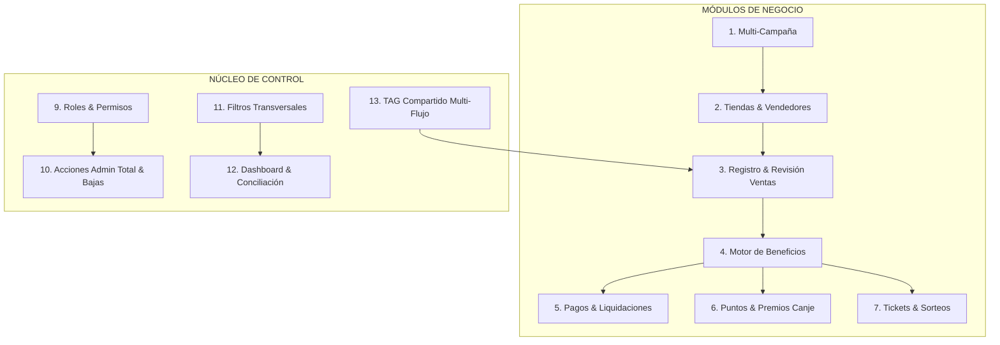

# PLAN DE IMPLEMENTACIÓN Y DIAGNÓSTICO INTEGRAL: PLATAFORMA SKYWORTH
## Requerimientos Funcionales, Ampliación Multi-Campaña, Bono Vendedor y Administración

> **Referencia base:** [Informe_Complementario_Skyworth_Bono_Vendedor_Administracion.md](file:///c:/Users/pauln/OneDrive/Escritorio/ninabit/BONO%20SKYWORTH/frontend_bono_vendedor3/Informe_Complementario_Skyworth_Bono_Vendedor_Administracion.md)  
> **Ámbito de aplicación:** Backend ([backend_bono_vendedor](file:///c:/Users/pauln/OneDrive/Escritorio/ninabit/BONO%20SKYWORTH/backend_bono_vendedor)) y Frontend ([frontend_bono_vendedor3](file:///c:/Users/pauln/OneDrive/Escritorio/ninabit/BONO%20SKYWORTH/frontend_bono_vendedor3))  
> **Fecha de diagnóstico:** Octubre 2026  
> **Elaborado para:** Dirección y Equipo de Desarrollo (Paul Nina & Yassir Quisbert | Grupo Empresarial Quisbert S.R.L.)

---

## 1. RESUMEN EJECUTIVO Y DIAGNÓSTICO GENERAL

La plataforma Skyworth cuenta actualmente con una base funcional activa compuesta por dos módulos principales:
1. **Bono Vendedor Inicial:** Registro de ventas por parte del vendedor con carga de 3 fotografías, revisión por revisor/supervisor de ciudad, aprobación/rechazo, exportación de reportes y pago directo individual con voucher QR.
2. **Cliente Final / Bandeo / Ruleta:** Registro de clientes por operadores de bandeo, ruleta de premios con inventario por impulsador, sorteos quincenales y sorteo final, e integración de WhatsApp/Chatbot.

### Diagnóstico de Brechas Principales (Gap Analysis)
A pesar de tener operativas las pantallas básicas, la arquitectura actual presenta desacoplamientos importantes frente a los requerimientos del **Informe Complementario**:

| Área Clave | Estado Actual en Código | Requerimiento del Informe Complementario | Nivel de Brecha |
| :--- | :--- | :--- | :---: |
| **Multi-Campaña Unificada** | `Campana` (vendedores) y `CampanaCliente` (ruleta) son tablas y flujos totalmente separados y no parametrizables en conjunto. | Una campaña centralizada que puede activar de forma independiente reglas para vendedor, tienda y cliente final. Duplicación y versionado de reglas. | **ALTO** |
| **Vínculo Tienda - Vendedor** | Tienda es un texto libre en `vendedores.tienda`; la tabla `tiendas` está oculta en frontend y desvinculada (`tienda_id` legacy). | Tienda como entidad identificable con código, asignación N-M a vendedores, fotografía histórica de datos en la venta, y soporte de incentivos a tiendas. | **CRÍTICO** |
| **TAG Compartido Multi-Flujo** | Un serial usado en un flujo bloquea globalmente su uso en cualquier otro flujo debido a un booleano global `bloqueado` o estado único `USADO`. | Un mismo TAG debe poder participar en Bono Vendedor Y en Cliente Final/Bandeo en la misma campaña sin bloquearse mutuamente. | **CRÍTICO** |
| **Ciclo de Venta y Observación** | Estados: `PENDIENTE`, `APROBADA`, `RECHAZADA`, `CERRADA`. No hay flujo de subsanación de observaciones. | Estado `OBSERVADA` con notificación, reemplazo de evidencias por el vendedor conservando historial, y reenvío para reevaluación. | **MEDIO** |
| **Puntos y Premios Vendedor** | No existe catálogo ni módulo de canje para vendedores (sólo existe ruleta para cliente final). | Cartera de puntos auditable, catálogo de premios con stock, solicitudes de canje, reserva consistente y comprobante de entrega. | **ALTO** |
| **Tickets y Sorteos de Vendedor** | Solo existen `TicketCliente` y sorteos fijos quincenal/final para clientes. | Tickets digitales y cupones físicos para vendedores y tiendas. Tómbola configurable multi-participante. | **ALTO** |
| **Cierres y Liquidaciones** | Pago directo 1 a 1 a vendedor. No hay lotes ni estados de cierre (`en cierre`, `autorizado`, etc.). | Lotes de liquidación auditables por campaña, vendedor y tienda, con tratamiento de retenciones e incidencias de regularización. | **MEDIO-ALTO** |
| **Bajas y Seguridad Admin Total** | `fullDelete` disponible para revisores y admin con confirmación simple de navegador; reseteo destructivo directo. | Bajas restringidas exclusivamente a Administrador Total en API y UI, con justificación obligatoria, análisis de dependencias e incidencias. | **ALTO** |
| **Roles y Permisos Granulares** | Enums fijos en backend y matriz de rutas frontend; sin roles Operativo ni Visor, ni permisos por acción/ámbito en API. | Roles configurables (Total, Operativo, Supervisor, Encargado, Visor) con acciones granulares y ámbito por ciudad/tienda reforzado en backend. | **ALTO** |
| **Filtros y Conciliación** | Filtros heterogéneos entre módulos; tienda no incluida en filtros principales. | Filtros transversales en cascada (Depto → Ciudad → Tienda; Categoría → Producto) y conciliación matemática estricta con exportaciones. | **MEDIO** |

---

## 2. MATRIZ DE DETALLE: REQUERIMIENTOS VS DESARROLLADO VS FALTANTE



### 2.1 Sección 1: Configuración de Múltiples Campañas
- **Lo Desarrollado:**
  - [Campana.java](file:///c:/Users/pauln/OneDrive/Escritorio/ninabit/BONO%20SKYWORTH/backend_bono_vendedor/src/main/java/com/ninabit/bono/modules/campaign/Campana.java) básica con fechas de inicio/fin, nombre y subtítulo.
  - Relación [CampanaProducto.java](file:///c:/Users/pauln/OneDrive/Escritorio/ninabit/BONO%20SKYWORTH/backend_bono_vendedor/src/main/java/com/ninabit/bono/modules/campaign/CampanaProducto.java) con asignación de `puntos` y `bonoBs`.
  - Pantalla [CampaignsPage.tsx](file:///c:/Users/pauln/OneDrive/Escritorio/ninabit/BONO%20SKYWORTH/frontend_bono_vendedor3/src/pages/admin/CampaignsPage.tsx) con CRUD simple de campañas y asignación de productos a campañas.
- **Lo Faltante:**
  - **Duplicar Campaña:** Endpoint y botón para clonar parámetros y catálogo de productos sin copiar ventas, participantes ni premios ganados.
  - **Alcance de Participación:** Habilitar/deshabilitar por campaña: lista blanca/negra de tiendas, ciudades y categorías de producto.
  - **Matriz de Beneficios Habilitados:** Configurar qué activa la campaña: Bono Vendedor (Bs), Puntos Vendedor, Bono Tienda, Tickets Vendedor, Cupones Físicos, Bandeo/Ruleta Cliente.
  - **Versionado de Reglas:** Historial de modificaciones de reglas por campaña con usuario, fecha y motivo; regla inmutable para ventas ya aprobadas.
  - **Estados de Campaña:** Borrador, Activa, Pausada, Cerrada, Archivada.

---

### 2.2 Sección 2: Relación Vendedor - Tienda - Venta
- **Lo Desarrollado:**
  - Entidad [Tienda.java](file:///c:/Users/pauln/OneDrive/Escritorio/ninabit/BONO%20SKYWORTH/backend_bono_vendedor/src/main/java/com/ninabit/bono/modules/tienda/Tienda.java) y [TiendaController.java](file:///c:/Users/pauln/OneDrive/Escritorio/ninabit/BONO%20SKYWORTH/backend_bono_vendedor/src/main/java/com/ninabit/bono/modules/tienda/TiendaController.java) existentes en backend.
  - Pantalla [TiendasPage.tsx](file:///c:/Users/pauln/OneDrive/Escritorio/ninabit/BONO%20SKYWORTH/frontend_bono_vendedor3/src/pages/admin/TiendasPage.tsx) existente pero oculta (`hidden: true` en el menú).
  - Vendedor con campo de texto libre `tienda` en [Vendedor.java](file:///c:/Users/pauln/OneDrive/Escritorio/ninabit/BONO%20SKYWORTH/backend_bono_vendedor/src/main/java/com/ninabit/bono/modules/vendor/Vendedor.java).
- **Lo Faltante:**
  - **Normalización de Tienda:** Código único de tienda, canal/tipo (Retail, Mayorista, Distribuidor, Mercado), ciudad, departamento, titular, teléfono.
  - **Asignación N-M Vendedor ↔ Tienda:** Tabla intermedia `vendedor_tienda` con vigencia y estado. Un vendedor puede pertenecer a más de una tienda y viceversa.
  - **Fotografía Comercial Histórica en la Venta:** Al registrar la venta, almacenar en `ventas` los datos de la tienda elegida (`tienda_id`, nombre comercial histórico, código, ciudad) para no alterar históricos ante reasignaciones.
  - **Selección de Tienda en Registro:** En [RegisterSalePage.tsx](file:///c:/Users/pauln/OneDrive/Escritorio/ninabit/BONO%20SKYWORTH/frontend_bono_vendedor3/src/pages/RegisterSalePage.tsx), selector obligatorio de tienda entre las asignadas al vendedor.
  - **Revisión de Tienda:** El revisor debe ver la tienda seleccionada y poder corregirla justificadamente antes de aprobar.
  - **Beneficiario Tienda:** Soporte para asociar titular de cobro de tienda si la campaña contempla incentivo al canal.

---

### 2.3 Sección 3: Registro y Revisión de Ventas
- **Lo Desarrollado:**
  - Registro de venta en [VentaController.java](file:///c:/Users/pauln/OneDrive/Escritorio/ninabit/BONO%20SKYWORTH/backend_bono_vendedor/src/main/java/com/ninabit/bono/modules/sale/VentaController.java) con carga de 3 fotos fijas (TAG, Póliza, Nota).
  - Verificación de serial en `serialRepository.findBySerial`.
  - Restricción de semanas hacia atrás (`venta_fecha_max_semanas`).
  - Pantalla [ReviewsPage.tsx](file:///c:/Users/pauln/OneDrive/Escritorio/ninabit/BONO%20SKYWORTH/frontend_bono_vendedor3/src/pages/admin/ReviewsPage.tsx) con visor de fotos, aprobación y rechazo con historial de motivos en JSON.
  - Notificaciones automáticas por correo al aprobar o rechazar.
- **Lo Faltante:**
  - **Estado OBSERVADA y Flujo de Subsanación:**
    - Estado en entidad [Venta.java](file:///c:/Users/pauln/OneDrive/Escritorio/ninabit/BONO%20SKYWORTH/backend_bono_vendedor/src/main/java/com/ninabit/bono/modules/sale/Venta.java): agregar `REGISTRADA`, `OBSERVADA`.
    - Cuando un revisor observa una venta (ej: "foto de póliza ilegible"): pasa a `OBSERVADA`.
    - En [MySalesPage.tsx](file:///c:/Users/pauln/OneDrive/Escritorio/ninabit/BONO%20SKYWORTH/frontend_bono_vendedor3/src/pages/MySalesPage.tsx), el vendedor ve la alerta, el motivo exacto, y un botón para **reemplazar únicamente el archivo observado y reenviar**.
    - Mantener historial de versiones de los archivos adjuntos sustituidos.
  - **Idempotencia de Aprobación:** Mecanismo transaccional que impida doble acreditación ante clics dobles simultáneos o peticiones concurrentes.
  - **Asignación de Expedientes:** Capacidad de asignar colas de revisión a supervisores específicos por zona o tienda.
  - **Documentos Parametrizables por Campaña:** Permitir que la campaña defina qué fotografías se exigen y con qué etiquetas.

---

### 2.4 Sección 4: Motor de Beneficios del Bono Vendedor
- **Lo Desarrollado:**
  - Asignación de puntos y bono en `CampanaProducto` sumados en `VentaCampana`.
- **Lo Faltante:**
  - **Independencia de Beneficios:** Soporte para bono en Bs = 0 con puntos > 0, o viceversa, y tickets digitales por modelo.
  - **Beneficio Separado para Tienda:** Cálculo de comisión o incentivo para el comercio independiente del vendedor.
  - **Estados de los Beneficios:** En [VentaCampana.java](file:///c:/Users/pauln/OneDrive/Escritorio/ninabit/BONO%20SKYWORTH/backend_bono_vendedor/src/main/java/com/ninabit/bono/modules/sale/VentaCampana.java), estados independientes: `ESTIMADO`, `ACREDITADO`, `EN_CIERRE`, `PAGADO`, `REVERTIDO`.
  - **Ajustes Compensatorios:** En caso de corrección autorizada de una venta histórica, generar un registro de movimiento de ajuste con motivo y autorización, sin sobrescribir montos originales.

---

### 2.5 Sección 5: Pagos y Liquidaciones
- **Lo Desarrollado:**
  - Endpoint `payVendor` que sube comprobante directo y vincula `pago_id` a las ventas aprobadas.
  - Exportación de reporte Excel con códigos QR de vendedores.
  - Pantalla [PaymentsAdminPage.tsx](file:///c:/Users/pauln/OneDrive/Escritorio/ninabit/BONO%20SKYWORTH/frontend_bono_vendedor3/src/pages/PaymentsAdminPage.tsx) con filtro de campaña, ciudad, fechas y diálogo de pago individual.
- **Lo Faltante:**
  - **Gestión de Lotes de Cierre:** Crear entidad `LoteLiquidacion` con estados: `PENDIENTE`, `EN_CIERRE`, `AUTORIZADO`, `PAGADO`, `OBSERVADO`, `ANULADO`.
  - **Liquidación a Tiendas:** Soporte para generar lotes de pago destinados a tiendas cuando aplique incentivo comercial.
  - **Exclusión / Observación Individual en Lote:** Poder observar o retener el pago de un vendedor particular sin congelar el resto del lote.
  - **Incidencia de Regularización:** Si una venta ya pagada es anulada por fraude o devolución, bloquear el borrado directo y generar una tarea de compensación/descuento en la próxima liquidación.
  - **Distinción en Perfil:** Vista en [MyPaymentsPage.tsx](file:///c:/Users/pauln/OneDrive/Escritorio/ninabit/BONO%20SKYWORTH/frontend_bono_vendedor3/src/pages/MyPaymentsPage.tsx) de: Bonos Ganados (estimados), Aprobados para Liquidación, y Pagados (con link al comprobante).

---

### 2.6 Sección 6: Puntos y Premios para Vendedores
- **Lo Desarrollado:**
  - Campo numérico `puntos` acumulado en `Venta` y sumado en estadísticas.
  - Solo existe catálogo de premios para la Ruleta de Cliente Final (`PremioRuleta`).
- **Lo Faltante:**
  - **Cartera de Puntos (Ledger):** Tabla `movimiento_puntos_vendedor` que registre abonos por venta aprobada, débitos por canje, reversiones por anulación y ajustes administrativos.
  - **Catálogo de Premios Vendedor:** Entidad `PremioVendedor` con nombre, foto, costo en puntos, stock disponible, descripción y restricciones.
  - **Módulo de Canjes:**
    - Solicitud de canje por el vendedor en su portal (`/v/canjes`).
    - Reserva atómica de puntos y stock.
    - Flujo administrativo: Pendiente → Aprobado / Rechazado → Entregado (con subida de comprobante de entrega).
    - Liberación de reserva en caso de rechazo o cancelación.
    - Política de campaña: descontar costo exacto o reiniciar saldo a cero según regla comercial.

---

### 2.7 Sección 7: Tickets Digitales, Cupones Físicos y Sorteos
- **Lo Desarrollado:**
  - `TicketCliente` generado al registrar compras de cliente final.
  - [SorteoTombolaService.java](file:///c:/Users/pauln/OneDrive/Escritorio/ninabit/BONO%20SKYWORTH/backend_bono_vendedor/src/main/java/com/ninabit/bono/modules/clientcampaign/SorteoTombolaService.java) y [TombolaSorteoPage.tsx](file:///c:/Users/pauln/OneDrive/Escritorio/ninabit/BONO%20SKYWORTH/frontend_bono_vendedor3/src/pages/admin/TombolaSorteoPage.tsx) atados a clientes finales y esquemas quincenales / finales.
- **Lo Faltante:**
  - **Tickets Digitales de Vendedor:** Emisión de tickets automáticos al aprobar una venta de campaña con sorteo para vendedores. Identificadores únicos y visualización en el perfil del vendedor.
  - **Módulo de Cupones Físicos:** Registro y control de talonarios entregados a tiendas/vendedores (rango de numeración, cantidad, persona receptora, fecha, actas). Conversión controlada a digital si la campaña lo requiere.
  - **Tómbola Reutilizable Multi-Público:** Parametrizar la tómbola para elegir:
    * Campaña objetivo.
    * Tipo de participante: Cliente Final, Vendedor o Tienda.
    * Filtro por segmento geográfico o tienda.
    * Generación de actas, ganadores y suplentes inmutables.

---

### 2.8 Sección 8: Perfil del Vendedor y Experiencia Móvil
- **Lo Desarrollado:**
  - [VendorDashboard.tsx](file:///c:/Users/pauln/OneDrive/Escritorio/ninabit/BONO%20SKYWORTH/frontend_bono_vendedor3/src/pages/VendorDashboard.tsx), [MySalesPage.tsx](file:///c:/Users/pauln/OneDrive/Escritorio/ninabit/BONO%20SKYWORTH/frontend_bono_vendedor3/src/pages/MySalesPage.tsx), [MyPaymentsPage.tsx](file:///c:/Users/pauln/OneDrive/Escritorio/ninabit/BONO%20SKYWORTH/frontend_bono_vendedor3/src/pages/MyPaymentsPage.tsx), [VendorProfilePage.tsx](file:///c:/Users/pauln/OneDrive/Escritorio/ninabit/BONO%20SKYWORTH/frontend_bono_vendedor3/src/pages/VendorProfilePage.tsx).
  - Carga y compresión de fotos antes de enviar.
- **Lo Faltante:**
  - Selector de tiendas asignadas en el perfil y en el formulario de venta.
  - Tarjetas de puntos disponibles por campaña con acceso al catálogo de canjes.
  - Sección de tickets digitales obtenidos en campañas activas.
  - Pestaña o filtro de "Ventas Observadas" con acción directa de corrección y reenvío.
  - Optimización de experiencia táctil en smartphones para agilizar la lectura de serial y carga de fotos.

---

### 2.9 Sección 9: Panel Administrativo, Roles y Permisos Granulares
- **Lo Desarrollado:**
  - Autenticación JWT con roles en enum `Usuario.Rol`: `ADMIN`, `VENDOR`, `REVIEWER`, `SUPERVISOR`, `TECNICO`, `OPERADOR_BANDEO`.
  - Tabla `rol_permisos` que almacena una lista JSON de rutas frontend permitidas.
  - Filtro por ciudad para el rol `REVIEWER`.
- **Lo Faltante:**
  - **Nuevos Roles Específicos:**
    1. `ADMIN_TOTAL`: Control maestro, asignación de roles, bajas sensibles.
    2. `ADMIN_OPERATIVO`: Operación diaria, campañas, sin permisos de borrado destructivo.
    3. `ENCARGADO_TIENDA`: Visualización exclusiva de ventas y comisiones de su propia tienda.
    4. `VISOR`: Modo solo lectura de dashboards y reportes asignados, con permiso de exportación configurable.
  - **Permisos por Acción en Backend:** Matriz de acciones: `VER`, `CREAR`, `EDITAR`, `IMPORTAR`, `REVISAR`, `APROBAR`, `PAGAR`, `CANJEAR`, `EXPORTAR`, `SORTEAR`, `ANULAR`, `ADMIN_USUARIOS`.
  - **Control de Ámbito en API:** En endpoints de consulta y mutación, validar en el servidor que el usuario no pueda acceder a datos de tiendas o ciudades ajenas a su asignación mediante inyección de query params.

---

### 2.10 Sección 10: Edición, Corrección y Acciones de Baja por Administrador Total
- **Lo Desarrollado:**
  - Endpoint destructivo `/sales/{id}/full-delete` con `@PreAuthorize("hasAnyRole('ADMIN', 'REVIEWER')")` que borra archivos y resetea serial sin validar estado de pago ni auditoría de motivo.
- **Lo Faltante:**
  - **Restricción Exclusiva a Admin Total:** Prohibir cualquier endpoint de eliminación o anulación destructiva a roles inferiores a `ADMIN_TOTAL` tanto en frontend como en el backend.
  - **Modal de Impacto y Dependencias:** Antes de confirmar una baja en frontend, consultar al backend el árbol de dependencias (¿Tiene pago asociado? ¿Generó puntos consumidos? ¿Tiene tickets ganadores?).
  - **Motivo Obligatorio y Auditoría Estricta:** Registro de justificación obligatoria en `auditoria` con usuario, IP, fecha y motivo detallado.
  - **Baja Lógica / Anulación en lugar de Borrado Físico:** En ventas y entidades comerciales, cambiar estado a `ANULADA` y revertir beneficios pendientes, manteniendo el registro en base de datos para trazabilidad contable.
  - **Incidencia Administrativa en Ventas Pagadas:** Si la venta ya fue pagada, bloquear la eliminación directa y dirigir a un flujo de incidencia de regularización.

---

### 2.11 Sección 11: Filtros Coherentes y Transversales
- **Lo Desarrollado:**
  - Filtros parciales en [ReviewsPage.tsx](file:///c:/Users/pauln/OneDrive/Escritorio/ninabit/BONO%20SKYWORTH/frontend_bono_vendedor3/src/pages/admin/ReviewsPage.tsx) (estado, ciudad, búsqueda, fechas, campaña).
  - Filtros parciales en [PaymentsAdminPage.tsx](file:///c:/Users/pauln/OneDrive/Escritorio/ninabit/BONO%20SKYWORTH/frontend_bono_vendedor3/src/pages/PaymentsAdminPage.tsx) (campaña, ciudad, fechas, estado).
- **Lo Faltante:**
  - **Componente Unificado de Filtros:** Barra de filtros estándar reutilizable en todos los módulos con: Campaña, Categoría, Producto/Modelo, Departamento, Ciudad, Tienda, Vendedor, Estado, Beneficiario, Fechas.
  - **Filtros en Cascada:**
    * Seleccionar Departamento filtra automáticamente las Ciudades y Tiendas elegibles.
    * Seleccionar Categoría filtra los Modelos/Productos disponibles.
  - **Indicadores de Filtro:** Contador de registros filtrados, chips de filtros activos y botón "Limpiar todo".
  - **Exportación Fidedigna:** La exportación a Excel debe contemplar la totalidad de registros que coinciden con los filtros aplicados en el backend, no únicamente la página visible.

---

### 2.12 Sección 12: Dashboards, Reportes y Conciliación
- **Lo Desarrollado:**
  - [AdminDashboardController.java](file:///c:/Users/pauln/OneDrive/Escritorio/ninabit/BONO%20SKYWORTH/backend_bono_vendedor/src/main/java/com/ninabit/bono/modules/admin/AdminDashboardController.java) y [AdminDashboardPage.tsx](file:///c:/Users/pauln/OneDrive/Escritorio/ninabit/BONO%20SKYWORTH/frontend_bono_vendedor3/src/pages/admin/AdminDashboardPage.tsx) con métricas de ventas (aprobadas, pendientes, rechazadas), vendedores y seriales.
- **Lo Faltante:**
  - **Dashboard Ejecutivo Centralizado:**
    * Selector superior de Campaña (o "Consolidado Global").
    * Tarjetas KPI detalladas: Ventas por estado, Bonos (estimados vs pagados), Puntos (ganados vs canjeados), Tickets activos, Stock de premios, Cupones físicos entregados.
    * **Drill-Down Interactivo:** Hacer clic en cualquier tarjeta abre el listado correspondiente con los mismos filtros preconfigurados.
  - **Conciliación Matemática Estricta:** Garantizar que el número mostrado en cualquier tarjeta coincida exactamente con la sumatoria de las filas del reporte descargable del mismo ámbito.
  - **Separación Vendedor vs Cliente:** Tarjetas y gráficos claramente separados para no mezclar bandeo de cliente con comisiones de vendedor.

---

### 2.13 Sección 13: TAG Compartido entre Flujos sin Duplicados
- **Lo Desarrollado:**
  - Tabla `serial` con columnas `registroCompradorId` y `registroVendedorId`.
- **Lo Faltante:**
  - **Desacoplamiento de Estado Global:** Actualmente `estado = USADO` o `bloqueado = true` inhabilita el serial para ambos flujos.
  - **Regla de Convivencia:** Permitir que un TAG sea registrado una vez en Bono Vendedor Y una vez en Cliente Final/Bandeo para la misma campaña:
    * `usado_bono_vendedor` (boolean o relación a Venta)
    * `usado_cliente_final` (boolean o relación a RegistroCliente)
  - **Restricción Intra-Flujo:** Si un vendedor intenta registrar un serial ya usado en Bono Vendedor dentro de la misma campaña, rechazar indicando la venta original. Idem para cliente final.
  - **Filtros en Bandeo:** Incorporar los filtros de Campaña, Categoría, Modelo, Ciudad, Tienda e Impulsador a las pantallas de bandeo y ruleta.

---

### 2.14 Sección 14: Verificación contra las 18 Pruebas de Aceptación
El plan de implementación debe culminar con la ejecución exitosa de los 18 casos de prueba definidos en el informe:
1. Vendedor asignado a 2 tiendas y venta en ambas.
2. Exclusión de tienda en campaña con mensaje explicativo.
3. Venta observada, corrección de archivo y aprobación.
4. Idempotencia en aprobación de bono y puntos.
5. Dos campañas concurrentes sobre el mismo modelo.
6. Bloqueo de serial repetido, restringido y no encontrado.
7. Cierre de pago con comprobante e imposición de liquidación única.
8. Canje de puntos con reserva atómica y manejo de stock concurrente.
9. Tickets de vendedor en perfil sin interferir con tickets de cliente.
10. Concordancia matemática entre filtros, totales en pantalla y exportación.
11. Roles Operativo y Visor con bloqueo por API en tiendas ajenas.
12. Restricción de baja de venta exclusiva al Administrador Total.
13. Anulación de venta y bloqueo de venta pagada abriendo incidencia.
14. Convivencia de TAG en órdenes: Vendedor → Cliente y Cliente → Vendedor.
15. Bloqueo de doble registro del mismo TAG en el mismo flujo.
16. Anulación de venta de vendedor manteniendo intacto el registro de cliente final.
17. Filtros completos y exportación en módulo de bandeo.
18. Drill-down interactivo en dashboard con coincidencia de totales.

---

## 3. PLAN DE IMPLEMENTACIÓN POR FASES (ROADMAP TÉCNICO)

A continuación se detalla el cronograma de ejecución estructurado en **6 Fases de Desarrollo** e integración continua:

```
┌─────────────────────────────────────────────────────────────────────────────┐
│ FASE 1: Dominio de Tiendas, Asignaciones y TAG Multi-Flujo                 │
│ ├─ Modelo de Tiendas completo y asignación Vendedor-Tienda-Campaña         │
│ └─ Desacoplamiento de validación de TAG (Bono vs Cliente)                   │
├─────────────────────────────────────────────────────────────────────────────┤
│ FASE 2: Ciclo de Vida de Ventas y Flujo de Subsanación de Observadas        │
│ ├─ Estados: REGISTRADA, PENDIENTE, OBSERVADA, APROBADA, ANULADA             │
│ └─ Reemplazo de evidencias por vendedor e historial de revisiones           │
├─────────────────────────────────────────────────────────────────────────────┤
│ FASE 3: Seguridad, Roles Granulares (Admin Total/Operativo/Visor) y Bajas  │
│ ├─ Control de acceso granular por acción y ámbito en Spring Security        │
│ └─ Restricción de bajas a Admin Total con análisis de impacto               │
├─────────────────────────────────────────────────────────────────────────────┤
│ FASE 4: Parametrización de Campañas, Puntos, Premios de Vendedor y Sorteos │
│ ├─ Duplicar/versionar campañas y reglas independientes                      │
│ ├─ Catálogo de premios de canje para vendedores y reservas atómicas         │
│ └─ Tickets digitales de vendedor y tómbola multi-participante               │
├─────────────────────────────────────────────────────────────────────────────┤
│ FASE 5: Liquidaciones, Cierres por Lotes y Regularización de Incidencias    │
│ ├─ Entidad LotePago con flujo de autorización y pago a vendedores y tiendas │
│ └─ Gestión de incidencias administrativas para ventas pagadas anuladas      │
├─────────────────────────────────────────────────────────────────────────────┤
│ FASE 6: Filtros Transversales, Dashboards Ejecutivos y Pruebas Finales     │
│ ├─ Componente de filtros en cascada y sincronización con reportes Excel     │
│ ├─ Dashboard ejecutivo con drill-down interactivo                           │
│ └─ Validación de las 18 pruebas de aceptación funcionales                   │
└─────────────────────────────────────────────────────────────────────────────┘
```

---

### FASE 1: Modelo de Dominio de Tiendas, Asignaciones y TAG Multi-Flujo
*Objetivo:* Solucionar la deuda técnica de tiendas como texto libre y desacoplar la validación de seriales entre vendedor y cliente.

#### 1.1 Backend:
1. **Entidad `Tienda`:** Enriquecer [Tienda.java](file:///c:/Users/pauln/OneDrive/Escritorio/ninabit/BONO%20SKYWORTH/backend_bono_vendedor/src/main/java/com/ninabit/bono/modules/tienda/Tienda.java) con campos:
   - `codigo` (único, ej: `TND-LPZ-001`), `canal` (tipo: Retail, Distribuidor, etc.), `departamento`, `titularCobro`, `telefonoTitular`, `activo`.
2. **Entidad `VendedorTienda`:** Crear tabla asociativa:
   - `vendedor_id`, `tienda_id`, `fecha_asignacion`, `activo`, `campana_id` (opcional).
3. **Modificación en [Venta.java](file:///c:/Users/pauln/OneDrive/Escritorio/ninabit/BONO%20SKYWORTH/backend_bono_vendedor/src/main/java/com/ninabit/bono/modules/sale/Venta.java):**
   - Agregar columna `tienda_id` (FK a `tiendas`).
   - Agregar campos de snapshot histórico: `store_name_snapshot`, `store_code_snapshot`, `store_city_snapshot`.
4. **Desacoplamiento de TAG en [Serial.java](file:///c:/Users/pauln/OneDrive/Escritorio/ninabit/BONO%20SKYWORTH/backend_bono_vendedor/src/main/java/com/ninabit/bono/modules/serial/Serial.java) y [VentaController.java](file:///c:/Users/pauln/OneDrive/Escritorio/ninabit/BONO%20SKYWORTH/backend_bono_vendedor/src/main/java/com/ninabit/bono/modules/sale/VentaController.java):**
   - Modificar la regla de validación: En vez de rechazar si `estado == USADO`, verificar específicamente:
     * ¿Está usado en Bono Vendedor para esta campaña? (`registroVendedorId != null` para la misma campaña).
     * Si fue usado en Cliente Final, **PERMITIR** el registro de Bono Vendedor.
   - Mantener trazabilidad de ambos registros en el serial sin que uno sobreescriba al otro.

#### 1.2 Frontend:
1. **Reactivar y Mejorar [TiendasPage.tsx](file:///c:/Users/pauln/OneDrive/Escritorio/ninabit/BONO%20SKYWORTH/frontend_bono_vendedor3/src/pages/admin/TiendasPage.tsx):** Mostrar en el sidebar comercial, agregar formulario con código, canal y titular.
2. **Asignación en [VendorsPage.tsx](file:///c:/Users/pauln/OneDrive/Escritorio/ninabit/BONO%20SKYWORTH/frontend_bono_vendedor3/src/pages/admin/VendorsPage.tsx):** Modal para asignar tiendas autorizadas a un vendedor.
3. **Selector en [RegisterSalePage.tsx](file:///c:/Users/pauln/OneDrive/Escritorio/ninabit/BONO%20SKYWORTH/frontend_bono_vendedor3/src/pages/RegisterSalePage.tsx):**
   - El vendedor selecciona obligatoriamente una de sus tiendas autorizadas.
   - Vista previa con ciudad de la tienda y beneficios estimados antes de presionar enviar.

---

### FASE 2: Ciclo de Vida de Ventas y Flujo de Subsanación de Observadas
*Objetivo:* Implementar el estado `OBSERVADA` y permitir al vendedor corregir fotos sin duplicar ventas.

#### 2.1 Backend:
1. **Estados de Venta:** Actualizar enum `Venta.Estado`:
   - `REGISTRADA`, `PENDIENTE`, `OBSERVADA`, `APROBADA`, `RECHAZADA`, `ANULADA`.
2. **Endpoint de Observación:** `PUT /sales/{id}/observe`
   - Recibe motivo de observación y archivos específicos requeridos para sustitución.
   - Notifica al vendedor por correo y WhatsApp (si aplica).
3. **Endpoint de Subsanación por el Vendedor:** `PUT /sales/{id}/resubmit` (Rol: `VENDOR`)
   - Permite subir nuevas versiones de las fotos observadas.
   - Almacena las fotos anteriores en historial de evidencias (`evidencias_anteriores`).
   - Cambia estado a `PENDIENTE` para que vuelva a la cola del revisor.
4. **Idempotencia:** Bloqueo optimista o transaccional `@Transactional(isolation = Isolation.SERIALIZABLE)` en `approve` para garantizar ejecución única.

#### 2.2 Frontend:
1. **Modificación de [ReviewsPage.tsx](file:///c:/Users/pauln/OneDrive/Escritorio/ninabit/BONO%20SKYWORTH/frontend_bono_vendedor3/src/pages/admin/ReviewsPage.tsx):**
   - Botón "Observar Venta" que abre diálogo para ingresar el motivo de observación y marcar qué foto debe corregirse.
2. **Modificación de [MySalesPage.tsx](file:///c:/Users/pauln/OneDrive/Escritorio/ninabit/BONO%20SKYWORTH/frontend_bono_vendedor3/src/pages/MySalesPage.tsx):**
   - Tab o filtro para ventas "Observadas" resaltadas en color naranja/ámbar.
   - Botón "Corregir / Reenviar" que despliega modal con la indicación del revisor y campo de carga para la nueva foto.

---

### FASE 3: Seguridad, Roles Granulares y Acciones de Baja Controladas
*Objetivo:* Proteger la plataforma con permisos por acción y ámbito, reservando eliminaciones exclusivamente al Administrador Total.

#### 3.1 Backend:
1. **Ampliación de Roles y Permisos:**
   - Enriquecer `Usuario.Rol` con: `ADMIN_TOTAL`, `ADMIN_OPERATIVO`, `SUPERVISOR`, `REVISOR`, `ENCARGADO_TIENDA`, `VISOR`, `VENDOR`, `OPERADOR_BANDEO`.
   - Crear entidad `PermisoAccion`: rol, módulo, accion (`VER`, `CREAR`, `EDITAR`, `APROBAR`, `PAGAR`, `CANJEAR`, `EXPORTAR`, `ELIMINAR`).
   - Servicio `AuthorizationService` para verificar en cada endpoint `@PreAuthorize("@authService.can(authentication, 'VENTAS', 'ELIMINAR')")`.
2. **Filtro de Ámbito (Scope Security):**
   - Si el usuario tiene asignada una tienda o ciudad (ej. Encargado de Tienda o Revisor), el backend inyecta forzosamente la cláusula `WHERE v.tienda_id = :tiendaId` o `v.ciudad = :ciudad` ignorando cualquier parámetro URL adulterado.
3. **Blindaje de Bajas (`/sales/{id}/delete`):**
   - Permitido **ÚNICAMENTE** para `ADMIN_TOTAL`.
   - Validación pre-eliminación: Si la venta está pagada o tiene canjes/tickets ganadores, rechazar con código 409 y mensaje: *"Venta asociada a liquidación pagada. Debe tramitarse como incidencia de regularización."*
   - Registro obligatorio en tabla `auditoria` con usuario, justificación y snapshot de datos.

#### 3.2 Frontend:
1. **Matriz de Permisos en [UsersRolesPage.tsx](file:///c:/Users/pauln/OneDrive/Escritorio/ninabit/BONO%20SKYWORTH/frontend_bono_vendedor3/src/pages/admin/UsersRolesPage.tsx):**
   - Panel visual para asignar acciones permitidas y alcance (tiendas/ciudades) por rol y usuario.
2. **Diálogo de Baja Avanzado:**
   - Al hacer clic en "Dar de baja" (visible solo si es Admin Total), consultar endpoint pre-baja `/sales/{id}/deletion-impact` que devuelva lista de registros vinculados.
   - Campo de texto obligatorio para justificar el motivo.

---

### FASE 4: Parametrización de Campañas, Puntos, Premios de Vendedor y Sorteos
*Objetivo:* Multi-campaña flexible, catálogo de premios para canje de puntos de vendedor y sorteos multi-público.

#### 4.1 Backend:
1. **Mejoras en Campañas:**
   - Endpoint `POST /campaigns/{id}/duplicate`: copia parámetros, reglas de modelos y productos sin registros operativos.
   - Tabla `campana_tienda_excluida` o `campana_tienda_incluida` para filtrar tiendas participantes.
2. **Puntos y Premios de Vendedor:**
   - Entidad `PremioVendedor`: id, campana_id, nombre, descripcion, puntos_requeridos, stock, foto, activo.
   - Entidad `CanjePuntos`: id, vendedor_id, premio_id, puntos_consumidos, fecha_solicitud, estado (`PENDIENTE`, `APROBADO`, `RECHAZADO`, `ENTREGADO`), foto_comprobante.
   - Entidad `MovimientoPuntos`: auditoría contable de saldo (venta aprobada, canje reservado, canje revertido, ajuste manual).
3. **Tickets Digitales y Sorteos:**
   - Entidad `TicketVendedor`: campana_id, venta_id, vendedor_id, numero_ticket, estado.
   - Refactorizar [SorteoTombolaService.java](file:///c:/Users/pauln/OneDrive/Escritorio/ninabit/BONO%20SKYWORTH/backend_bono_vendedor/src/main/java/com/ninabit/bono/modules/clientcampaign/SorteoTombolaService.java): recibir parámetro `tipoParticipante` (`CLIENTE`, `VENDEDOR`, `TIENDA`) y consultar la fuente de tickets correspondiente.

#### 4.2 Frontend:
1. **Actualización de [CampaignsPage.tsx](file:///c:/Users/pauln/OneDrive/Escritorio/ninabit/BONO%20SKYWORTH/frontend_bono_vendedor3/src/pages/admin/CampaignsPage.tsx):**
   - Botón "Duplicar Campaña" y configuración de tiendas y beneficiarios elegibles.
2. **Nuevo Módulo de Premios y Canjes:**
   - Admin: `/admin/premios-vendedores` para gestionar catálogo de premios y autorizar solicitudes de canje.
   - Vendedor: `/v/canjes` para explorar catálogo de premios, ver saldo de puntos y solicitar canjes.
3. **Actualización de [TombolaSorteoPage.tsx](file:///c:/Users/pauln/OneDrive/Escritorio/ninabit/BONO%20SKYWORTH/frontend_bono_vendedor3/src/pages/admin/TombolaSorteoPage.tsx):**
   - Selector de campaña y tipo de sorteo (Clientes vs Vendedores vs Tiendas).

---

### FASE 5: Liquidaciones, Cierres por Lotes y Regularización de Incidencias
*Objetivo:* Proceso formal de pago por lotes auditables y gestión de regularizaciones ante anulaciones posteriores.

#### 5.1 Backend:
1. **Lotes de Liquidación:**
   - Entidades: `LoteLiquidacion` y `LoteLiquidacionDetalle`.
   - Estados: `BORRADOR`, `EN_REVISION`, `AUTORIZADO`, `PAGADO`, `ANULADO`.
   - Agrupación por campaña, ciudad o periodo. Admite liquidación a Vendedor o a Tienda.
2. **Gestión de Incidencias:**
   - Entidad `IncidenciaRegularizacion`: tipo (`VENTA_PAGADA_ANULADA`), venta_id, pago_id, monto_a_compensar, estado (`PENDIENTE`, `COMPENSADA`).
   - Al generar un nuevo lote, deducir automáticamente compensaciones pendientes del vendedor.

#### 5.2 Frontend:
1. **Evolución de [PaymentsAdminPage.tsx](file:///c:/Users/pauln/OneDrive/Escritorio/ninabit/BONO%20SKYWORTH/frontend_bono_vendedor3/src/pages/PaymentsAdminPage.tsx):**
   - Vista de "Generación de Lote de Cierre": seleccionar ventas aprobadas no pagadas, previsualizar totales, emitir lote.
   - Gestión de lotes en curso y subida masiva o individual de comprobantes bancarios.
   - Pestaña de "Incidencias de Regularización" para supervisar saldos pendientes por devoluciones.

---

### FASE 6: Filtros Transversales, Dashboards Ejecutivos y Pruebas Finales
*Objetivo:* Experiencia visual integral, reportes matemáticamente conciliables y validación de las 18 pruebas de aceptación.

#### 6.1 Backend:
1. **Endpoints de Dashboard Optimizados:**
   - Retorno de agregaciones agrupadas por campaña seleccionada o global en [AdminDashboardController.java](file:///c:/Users/pauln/OneDrive/Escritorio/ninabit/BONO%20SKYWORTH/backend_bono_vendedor/src/main/java/com/ninabit/bono/modules/admin/AdminDashboardController.java).
   - Separación estricta de métricas de vendedor y de cliente final.
2. **Especificación Dinámica de Filtros (`VentaSpecification`):**
   - Asegurar soporte de filtros combinados: Campaña + Categoría + Modelo + Depto + Ciudad + Tienda + Vendedor + Estado.

#### 6.2 Frontend:
1. **Componente de Filtros Reutilizable (`UniversalFilterBar.tsx`):**
   - Dropdowns dependientes en cascada (Departamento → Ciudad → Tienda; Categoría → Producto).
   - Botón "Limpiar filtros", badges de filtros activos y contador de resultados.
2. **Rediseño de [AdminDashboardPage.tsx](file:///c:/Users/pauln/OneDrive/Escritorio/ninabit/BONO%20SKYWORTH/frontend_bono_vendedor3/src/pages/admin/AdminDashboardPage.tsx):**
   - Selector de campaña en el encabezado.
   - Tarjetas métricas interactivas con clic directo que redirige a `ReviewsPage`, `PaymentsAdminPage` o `InventoryPage` con los filtros activos.
3. **Ejecución y Documentación de las 18 Pruebas de Aceptación:**
   - Verificación funcional punto a punto según la Sección 14 del informe.

---

## 4. ESTIMACIÓN DE ESFUERZO Y ASIGNACIÓN POR MÓDULOS

| Fase | Descripción de Tareas | Complejidad | Archivos Clave Involucrados |
| :--- | :--- | :---: | :--- |
| **Fase 1** | Dominio de Tiendas, Asignación N-M y Desacoplamiento TAG | Media | [Tienda.java](file:///c:/Users/pauln/OneDrive/Escritorio/ninabit/BONO%20SKYWORTH/backend_bono_vendedor/src/main/java/com/ninabit/bono/modules/tienda/Tienda.java), [Vendedor.java](file:///c:/Users/pauln/OneDrive/Escritorio/ninabit/BONO%20SKYWORTH/backend_bono_vendedor/src/main/java/com/ninabit/bono/modules/vendor/Vendedor.java), [Serial.java](file:///c:/Users/pauln/OneDrive/Escritorio/ninabit/BONO%20SKYWORTH/backend_bono_vendedor/src/main/java/com/ninabit/bono/modules/serial/Serial.java), [VentaController.java](file:///c:/Users/pauln/OneDrive/Escritorio/ninabit/BONO%20SKYWORTH/backend_bono_vendedor/src/main/java/com/ninabit/bono/modules/sale/VentaController.java), [RegisterSalePage.tsx](file:///c:/Users/pauln/OneDrive/Escritorio/ninabit/BONO%20SKYWORTH/frontend_bono_vendedor3/src/pages/RegisterSalePage.tsx), [TiendasPage.tsx](file:///c:/Users/pauln/OneDrive/Escritorio/ninabit/BONO%20SKYWORTH/frontend_bono_vendedor3/src/pages/admin/TiendasPage.tsx) |
| **Fase 2** | Estado OBSERVADA, flujo de subsanación e idempotencia | Media | [Venta.java](file:///c:/Users/pauln/OneDrive/Escritorio/ninabit/BONO%20SKYWORTH/backend_bono_vendedor/src/main/java/com/ninabit/bono/modules/sale/Venta.java), [VentaController.java](file:///c:/Users/pauln/OneDrive/Escritorio/ninabit/BONO%20SKYWORTH/backend_bono_vendedor/src/main/java/com/ninabit/bono/modules/sale/VentaController.java), [ReviewsPage.tsx](file:///c:/Users/pauln/OneDrive/Escritorio/ninabit/BONO%20SKYWORTH/frontend_bono_vendedor3/src/pages/admin/ReviewsPage.tsx), [MySalesPage.tsx](file:///c:/Users/pauln/OneDrive/Escritorio/ninabit/BONO%20SKYWORTH/frontend_bono_vendedor3/src/pages/MySalesPage.tsx) |
| **Fase 3** | Seguridad de Roles, Permisos por Acción, Ámbito y Bajas Admin Total | Alta | [Usuario.java](file:///c:/Users/pauln/OneDrive/Escritorio/ninabit/BONO%20SKYWORTH/backend_bono_vendedor/src/main/java/com/ninabit/bono/modules/user/Usuario.java), [SecurityConfig.java](file:///c:/Users/pauln/OneDrive/Escritorio/ninabit/BONO%20SKYWORTH/backend_bono_vendedor/src/main/java/com/ninabit/bono/config/SecurityConfig.java), [UsersRolesPage.tsx](file:///c:/Users/pauln/OneDrive/Escritorio/ninabit/BONO%20SKYWORTH/frontend_bono_vendedor3/src/pages/admin/UsersRolesPage.tsx), [ReviewsPage.tsx](file:///c:/Users/pauln/OneDrive/Escritorio/ninabit/BONO%20SKYWORTH/frontend_bono_vendedor3/src/pages/admin/ReviewsPage.tsx) |
| **Fase 4** | Campañas avanzadas, Premios de Vendedor, Puntos y Sorteos | Alta | [Campana.java](file:///c:/Users/pauln/OneDrive/Escritorio/ninabit/BONO%20SKYWORTH/backend_bono_vendedor/src/main/java/com/ninabit/bono/modules/campaign/Campana.java), `CanjePuntos.java`, [SorteoTombolaService.java](file:///c:/Users/pauln/OneDrive/Escritorio/ninabit/BONO%20SKYWORTH/backend_bono_vendedor/src/main/java/com/ninabit/bono/modules/clientcampaign/SorteoTombolaService.java), [CampaignsPage.tsx](file:///c:/Users/pauln/OneDrive/Escritorio/ninabit/BONO%20SKYWORTH/frontend_bono_vendedor3/src/pages/admin/CampaignsPage.tsx), [TombolaSorteoPage.tsx](file:///c:/Users/pauln/OneDrive/Escritorio/ninabit/BONO%20SKYWORTH/frontend_bono_vendedor3/src/pages/admin/TombolaSorteoPage.tsx) |
| **Fase 5** | Cierres por Lotes, Liquidaciones a Tienda e Incidencias | Media-Alta | `LoteLiquidacion.java`, [PagoController.java](file:///c:/Users/pauln/OneDrive/Escritorio/ninabit/BONO%20SKYWORTH/backend_bono_vendedor/src/main/java/com/ninabit/bono/modules/payment/PagoController.java), [PaymentsAdminPage.tsx](file:///c:/Users/pauln/OneDrive/Escritorio/ninabit/BONO%20SKYWORTH/frontend_bono_vendedor3/src/pages/PaymentsAdminPage.tsx) |
| **Fase 6** | Filtros en cascada, Dashboard ejecutivo y Pruebas de Aceptación | Media | `UniversalFilterBar.tsx`, [AdminDashboardPage.tsx](file:///c:/Users/pauln/OneDrive/Escritorio/ninabit/BONO%20SKYWORTH/frontend_bono_vendedor3/src/pages/admin/AdminDashboardPage.tsx), Generadores Excel |

---

## 5. MATRIZ DE RIESGOS Y MEDIDAS DE MITIGACIÓN

| Riesgo Identificado | Impacto | Probabilidad | Medida de Mitigación |
| :--- | :---: | :---: | :--- |
| **Migración de tiendas en ventas históricas** | Alto | Media | Mantener los datos históricos de texto en `store_name_snapshot` para ventas anteriores a la normalización, ejecutando un script de mapeo por similitud para las ventas existentes. |
| **Bloqueo accidental de TAGs entre flujos** | Crítico | Media | Implementar tests unitarios y de integración específicos para los casos de prueba 14 y 15 (TAG Vendedor ↔ Cliente Final) antes de subir a producción. |
| **Concurrencia en canjes de premios o aprobación de ventas** | Alto | Baja | Utilizar transacciones con aislamiento y bloqueo a nivel de fila (`SELECT ... FOR UPDATE` o `@Lock(PESSIMISTIC_WRITE)`) al descontar stock de premios y al aprobar beneficios de ventas. |
| **Sobrecarga de consultas en Dashboard con gran volumen** | Medio | Media | Mantener las consultas de agregación SQL directa (`COUNT`, `SUM`, `GROUP BY`) ya implementadas en `AdminDashboardController` sin cargar entidades completas en memoria. |
| **Alteración de permisos por manipulación de parámetros HTTP** | Alto | Baja | Forzar la validación de ámbito (tienda y ciudad) en los repositorios JPA y en los controllers de Spring, no solo en la interfaz React. |

---

## 6. CONCLUSIÓN Y SIGUIENTES PASOS

El informe complementario define un sistema comercial y administrativo de alto nivel que transformará la plataforma Skyworth en una solución integral multi-campaña. La base de código actual es limpia y sólida, lo que permitirá implementar las ampliaciones sin necesidad de reescribir la plataforma desde cero, sino evolucionando los módulos actuales de manera progresiva.

### Siguientes Pasos Recomendados:
1. **Aprobación de la arquitectura de datos** (especialmente la normalización de tiendas y desacoplamiento de TAGs).
2. **Inicio inmediato de la Fase 1:** Modelado de Tiendas, asignaciones de vendedores y corrección de la validación multi-flujo del TAG en `VentaController`.
3. **Revisión continua:** Validar cada fase frente a la lista de **18 Pruebas de Aceptación** para garantizar entregables 100% operativos.
